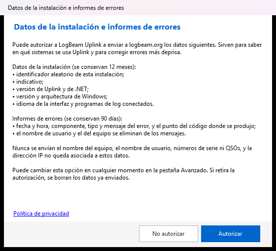
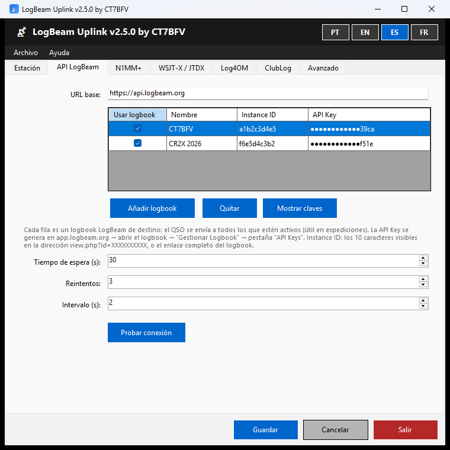
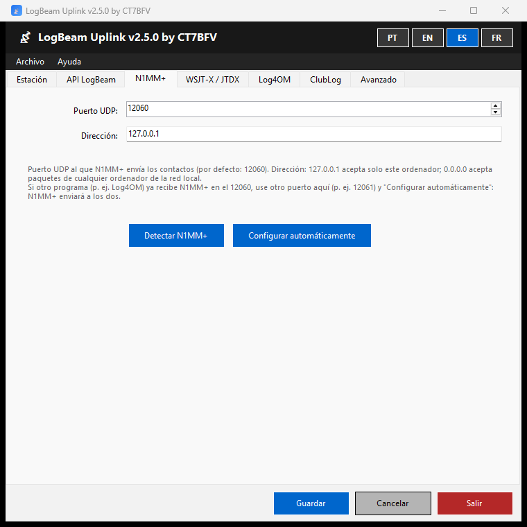
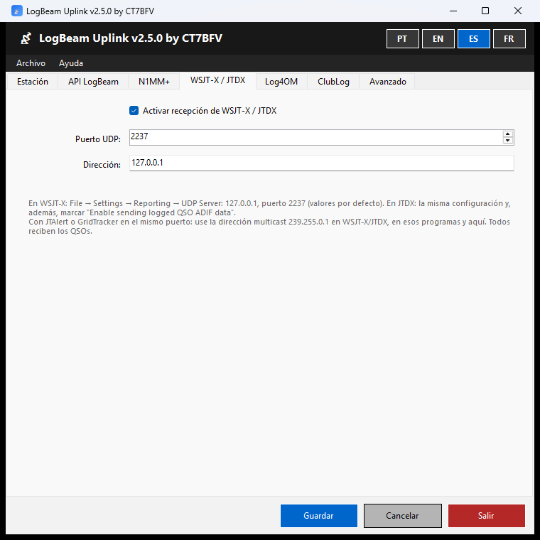
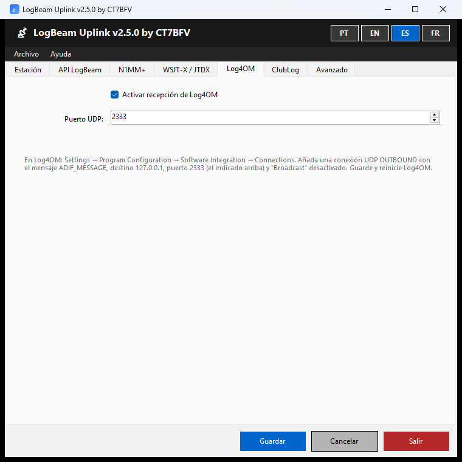
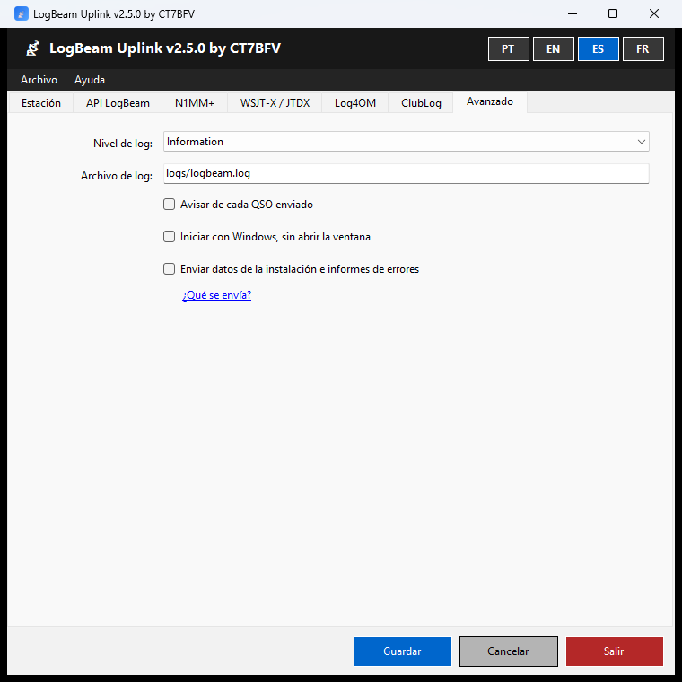

<h1 align="center">Manual de LogBeam Uplink 2.6</h1>

<a href="MANUAL.pt.md">Português</a> · <a href="MANUAL.en.md">English</a> · <b>Español</b> · <a href="MANUAL.fr.md">Français</a>

LogBeam Uplink es una aplicación para Windows y Linux que recibe los QSOs de **N1MM+**, **Not1MM** (Linux), **WSJT-X**, **JTDX** y **Log4OM** en el momento en que se registran y los envía a uno o varios logbooks de [LogBeam](https://logbeam.org) y, si lo activa, a **ClubLog**.

**Índice:** [1. Instalar](#1-instalar) · [2. Primer arranque](#2-primer-arranque) · [3. La ventana y el área de notificación](#3-la-ventana-y-el-área-de-notificación) · [4. Pestañas](#4-pestañas) · [5. Sin internet](#5-sin-internet) · [6. Exportar la sesión](#6-exportar-la-sesión) · [7. Actualizaciones](#7-actualizaciones) · [8. Solución de problemas](#8-solución-de-problemas) · [9. Desinstalar](#9-desinstalar) · [10. Linux](#10-linux)

## 1. Instalar

1. Descargue el instalador en **https://logbeam.org/uplink/** y compruebe la huella digital SHA-256 publicada en la página. En PowerShell, en la carpeta del archivo: `Get-FileHash .\LogBeamUplink-Setup-X.Y.Z.exe`.
2. Ejecute el instalador. No necesita privilegios de administrador ni .NET: se instala en `%LOCALAPPDATA%\Programs\LogBeam Uplink` y crea un acceso directo en el menú Inicio.

En Linux, ver la [sección 10](#10-linux).

> ⚠️ El programa es gratuito y de código abierto, y se distribuye **sin firma digital**. Por eso:
> - **SmartScreen:** si aparece «Windows protegió su PC», pulse «Más información» → «Ejecutar de todas formas».
> - **Control inteligente de aplicaciones (Windows 11):** puede bloquear el instalador sin opción de continuar. En ese caso hay que desactivarlo en Seguridad de Windows → Control de aplicaciones y navegador → Control inteligente de aplicaciones.

## 2. Primer arranque

La primera vez, Uplink pregunta si puede enviar a LogBeam los **datos de la instalación** y los **informes de errores**. La ventana enumera exactamente lo que se envía; no se envía nada sin pulsar «Autorizar». Puede cambiar la elección en cualquier momento en la pestaña **Avanzado**. Si retira la autorización, los datos ya enviados se borran del servidor.

## 3. La ventana y el área de notificación

- Cerrar la ventana con la **X** no cierra el programa: Uplink sigue funcionando, con su icono en el área de notificación. Para salir, use el botón **Salir** o el menú del icono.
- Un doble clic en el icono de Uplink, en el área de notificación, abre la ventana.
- Uplink solo se abre una vez: si lo abre de nuevo, la ventana que ya estaba abierta pasa al frente.
- Los botones **PT · EN · ES · FR**, en la parte superior de la ventana, cambian el idioma.

**Menú del icono** (botón derecho sobre el icono de Uplink):

| Opción | Para qué |
|---|---|
| Abrir | Muestra la ventana |
| Enviar a | Activa o desactiva cada logbook con un clic (p. ej., para pasar al logbook de un concurso). El cambio se guarda al momento |
| Iniciar servicio · Detener servicio | Activa o desactiva la recepción y el envío de QSOs |
| Salir | Cierra el programa |

**Avisos (junto al reloj):**

| Aviso | Cuándo |
|---|---|
| Error al enviar el QSO | Siempre |
| QSO enviado | Solo con «Avisar de cada QSO enviado» (pestaña Avanzado) |
| El QSO ya existía en el logbook | El QSO ya estaba allí (el servidor detecta duplicados al minuto). Solo con la misma opción |
| ✓ Confirmado por otro LogBeam | El corresponsal también tiene el QSO en un logbook de LogBeam |
| Puerto ocupado | No se puede recibir de un programa de log porque otro programa ocupa el puerto (ver la [sección 8](#8-solución-de-problemas)) |
| ClubLog: credenciales rechazadas | ClubLog rechazó el correo, la App Password o el indicativo (ver [ClubLog](#clublog)). Aparece una sola vez |

## 4. Pestañas

Después de cambiar cualquier cosa, pulse **Guardar**: el servicio se reinicia con la nueva configuración. **Cancelar** restablece lo que estaba guardado.

### Estación

**Indicativo:** se usa en el envío a ClubLog, salvo que se indique otro en la pestaña ClubLog. La ubicación de los corresponsales la gestiona el servidor de LogBeam.

### API LogBeam

Cada fila de la tabla es un logbook de LogBeam de destino. El QSO se envía a todos los que tengan marcado **Usar logbook** (por ejemplo, el logbook de una expedición y el personal).

1. **Añadir logbook**.
2. **Nombre:** libre, para reconocer el logbook en el menú del icono.
3. **Instance ID:** los 10 caracteres de la dirección `view.php?id=XXXXXXXXXX`, o el enlace completo del logbook (Uplink extrae el identificador).
4. **API Key:** se genera en app.logbeam.org → abrir el logbook → «Gestionar Logbook» → pestaña «API Keys». Tiene 64 caracteres.
5. **Probar conexión:** comprueba la clave y muestra de quién es el logbook («Conexión establecida: logbook de CT7XXX.»).
6. **Guardar**.

Las claves aparecen enmascaradas en la tabla (solo los 4 últimos caracteres); **Mostrar claves** las muestra completas. Al editar la celda, la clave aparece completa.

**URL base**, **Tiempo de espera**, **Reintentos** e **Intervalo** no necesitan cambiarse.

### N1MM+

- **Configurar automáticamente:** con N1MM+ cerrado, configura N1MM+ para enviar los contactos a Uplink. Antes de modificarlo se hace una copia de seguridad del archivo de configuración de N1MM+, y los destinos que ya existían se mantienen.
- **Detectar N1MM+:** indica si N1MM+ ya está configurado.
- **Puerto UDP** (por defecto 12060) y **Dirección** (127.0.0.1 = solo este ordenador; 0.0.0.0 = cualquier ordenador de la red local).

Si otro programa (p. ej., Log4OM) ya recibe N1MM+ en el puerto 12060, use aquí otro puerto (p. ej., 12061) y pulse «Configurar automáticamente»: N1MM+ enviará a los dos.

Para configurarlo a mano, ver el menú **Ayuda → Configurar N1MM+...**

### Not1MM

Solo en la versión Linux. Not1MM envía los QSOs en el formato de N1MM+, al puerto de la pestaña N1MM+ (por defecto 12060): el mismo receptor recibe los dos programas, y pueden estar abiertos a la vez.

- **Configurar automáticamente:** con Not1MM cerrado, activa el envío de contactos en las preferencias de Not1MM (`~/.config/not1mm/not1mm.json`), a 127.0.0.1 y al puerto de la pestaña N1MM+. Se hace una copia de seguridad del archivo antes de modificarlo.
- **Detectar Not1MM:** muestra si Not1MM ya está configurado. Si las preferencias todavía no existen, abra Not1MM una vez.

Para configurarlo a mano, en los ajustes de Not1MM: active el envío de paquetes N1MM y de contactos, con el destino **127.0.0.1:12060**.

### WSJT-X / JTDX

1. Marque **Activar recepción de WSJT-X / JTDX**.
2. En WSJT-X: File → Settings → Reporting → UDP Server **127.0.0.1**, puerto **2237** (los valores por defecto).
3. En JTDX: la misma configuración y, además, marque **«Enable sending logged QSO ADIF data»**.

> 💡 **Con JTAlert o GridTracker en el mismo puerto:** dos programas no pueden recibir del mismo puerto normal. Use una dirección **multicast**, por ejemplo **239.255.0.1**, en WSJT-X/JTDX (UDP Server), en esos programas y en el campo **Dirección** de Uplink. Así todos reciben los mismos paquetes. En multicast, Uplink solo acepta paquetes de este ordenador.

### Log4OM

1. Marque **Activar recepción de Log4OM**.
2. En Log4OM: Settings → Program Configuration → Software Integration → Connections. Añada una conexión **UDP OUTBOUND** con el mensaje **ADIF_MESSAGE**, destino **127.0.0.1**, puerto **2333** y **«Broadcast» desactivado**. Guarde y reinicie Log4OM.

### ClubLog

1. Marque **Activar envío en tiempo real**.
2. **Correo de ClubLog** y **App Password**: una «Application Password» creada en ClubLog, no la contraseña de acceso al sitio.
3. **Indicativo (opcional):** en blanco usa el de la pestaña Estación; si también está en blanco, el del programa de log.

Recibe los QSOs de todos los programas (N1MM+, Not1MM, WSJT-X, JTDX y Log4OM) y usa la misma cola sin internet que los logbooks. Si ClubLog rechaza el correo, la App Password o el indicativo, Uplink avisa una vez (notificación del sistema y mensaje en rojo en esta pestaña) y detiene el envío a ClubLog, porque ClubLog bloquea la IP de quien insiste con credenciales erróneas. Los QSOs quedan en la cola y se envían cuando se corrigen los datos y se pulsa Guardar.

### Avanzado

| Opción | Para qué |
|---|---|
| Nivel de log | Cantidad de información en el archivo de log. «Information» basta para el día a día; «Debug» para investigar un problema |
| Archivo de log | Dónde se guarda el log (por defecto, la carpeta `logs` de Uplink) |
| Avisar de cada QSO enviado | Aviso también para los QSOs enviados correctamente |
| Iniciar con Windows (en Linux, con el sistema), sin abrir la ventana | Uplink arranca con Windows, o con la sesión en Linux, solo con su icono en el área de notificación |
| Enviar datos de la instalación e informes de errores | La autorización del primer arranque; «¿Qué se envía?» muestra la lista |

## 5. Sin internet

Si un QSO no se puede enviar (sin red, servidor no disponible), queda en una cola y Uplink vuelve a intentarlo cada minuto, por orden de llegada. La cola se conserva al reiniciar Uplink y Windows.

Los errores que no se resuelven reenviando, como una API key revocada o un logbook borrado, no quedan en la cola: aparece el aviso de error y el motivo queda en el log.

## 6. Exportar la sesión

**Archivo → Exportar sesión a ADIF...** guarda en un archivo ADIF los QSOs enviados correctamente desde que arrancó el servicio.

## 7. Actualizaciones

Uplink comprueba si hay una versión nueva un minuto después de arrancar y, a partir de ahí, una vez al día mientras esté abierto. Si la comprobación falla (por ejemplo, sin red justo después de arrancar el ordenador), lo intenta de nuevo 15 minutos después. Cuando hay una versión nueva:

- con la ventana a la vista, pregunta si quiere abrir la página de descarga;
- con la ventana oculta, avisa en el área de notificación. En Windows, al hacer clic en el aviso se abre la página; en Linux, el aviso es una notificación del sistema;
- el menú del icono pasa a tener **Descargar la versión X**, que abre la página.

El aviso aparece como máximo una vez al día. También puede comprobarlo en cualquier momento en **Ayuda → Buscar actualizaciones...** En Windows, la versión nueva se instala con el instalador, encima de la anterior; en Linux, se instala el paquete nuevo encima del anterior. La configuración se mantiene. Las versiones nuevas están en https://logbeam.org/uplink/.

Hasta la versión 2.6.0, el aviso podía no aparecer: en Windows, use **Ayuda → Buscar actualizaciones...**; en Linux, consulte la página de descarga.

## 8. Solución de problemas

| Síntoma | Qué hacer |
|---|---|
| «Puerto ocupado» | Otro programa usa el mismo puerto. WSJT-X/JTDX: use multicast ([sección 4](#wsjt-x--jtdx)). N1MM+: use otro puerto y «Configurar automáticamente» |
| «API Key no válida» o «Instance ID no válido» al guardar | Compruebe la clave (64 caracteres) y el enlace del logbook; use «Probar conexión» |
| Los QSOs no llegan | Compruebe la configuración del programa de log ([sección 4](#4-pestañas)) y que el servicio está iniciado (menú del icono). Ponga el nivel de log en «Debug», haga un QSO y mire el archivo de log |
| Un QSO se corrigió o se borró en el programa de log | En la versión 2.6, las ediciones y los borrados no llegan a LogBeam ni a ClubLog. Está previsto para la 2.7 |
| Windows bloquea el instalador o el programa | Ver los avisos sobre SmartScreen y el Control inteligente de aplicaciones ([sección 1](#1-instalar)) |

**Archivos**, en la carpeta de instalación (`%LOCALAPPDATA%\Programs\LogBeam Uplink`); en Linux, ver la [sección 10](#10-linux):

| Archivo | Contenido |
|---|---|
| `settings.json` | Configuración. Las API keys y las contraseñas se guardan cifradas, legibles solo por el usuario de Windows que las guardó |
| `queue.json` | QSOs pendientes de envío |
| `logs\` | Un archivo de log por día, conservados 30 días |
| `telemetry.json` | Informes de errores pendientes de envío (solo con autorización) |

## 9. Desinstalar

Configuración de Windows → Aplicaciones → LogBeam Uplink → Desinstalar. El desinstalador borra el programa, los logs y el inicio con Windows. La configuración (`settings.json`) y la cola (`queue.json`) se quedan en la carpeta para que una reinstalación las aproveche; para eliminarlas, borre la carpeta `%LOCALAPPDATA%\Programs\LogBeam Uplink`.

En Linux: `sudo apt remove logbeam-uplink`. La configuración y la cola se quedan en `~/.config/logbeam-uplink`; para eliminarlas, borre esa carpeta.

## 10. Linux

La versión para Linux tiene las mismas pestañas, los mismos cuatro idiomas y el mismo núcleo que la versión para Windows. Las diferencias:

- **Instalar:** descargue el paquete `.deb` en **https://logbeam.org/uplink/**, compruebe el SHA-256 (`sha256sum logbeam-uplink_X.Y.Z_amd64.deb`) e instálelo con `sudo apt install ./logbeam-uplink_X.Y.Z_amd64.deb` (en ARM, por ejemplo Raspberry Pi OS de 64 bits, el paquete `_arm64.deb`). El paquete trae todo lo que necesita, sin instalar .NET. Aparece en el menú de aplicaciones como «LogBeam Uplink» y también se abre con el comando `logbeam-uplink`.
- **Programas de log:** WSJT-X, JTDX y Not1MM son nativos. N1MM+ y Log4OM funcionan en Wine y se configuran como en Windows, con el destino 127.0.0.1. Uplink busca N1MM+ en la carpeta Documentos del usuario (`N1MM Logger+`); si la carpeta Documentos de Wine es otra, use **Ayuda → Configurar N1MM+...**
- **Área de notificación:** el icono de Uplink aparece en el área de notificación del escritorio (probado en Cinnamon). Los avisos son notificaciones del sistema.
- **Iniciar con el sistema:** crea `~/.config/autostart/logbeam-uplink.desktop`, y Uplink arranca con la sesión, solo con su icono.
- **API keys y contraseñas:** cifradas con AES-256-GCM, con una clave aleatoria guardada en `credentials.key`, legible solo por el usuario.
- **Actualizaciones:** Uplink avisa como en Windows ([7. Actualizaciones](#7-actualizaciones)), con una notificación del sistema; se instala el paquete nuevo encima del anterior.

**Archivos**, en `~/.config/logbeam-uplink`:

| Archivo | Contenido |
|---|---|
| `settings.json` | Configuración, con las API keys y las contraseñas cifradas |
| `credentials.key` | La clave que cifra las API keys y las contraseñas. Sin ella no se pueden leer: copie la carpeta entera al cambiar de ordenador |
| `queue.json` | QSOs pendientes de envío |
| `logs/` | Un archivo de log por día, conservados 30 días |
| `telemetry.json` | Informes de errores pendientes de envío (solo con autorización) |

---

© 2026 Octávio Filipe Pereira Gonçalves (CT7BFV) · [GNU General Public License v3.0](https://www.gnu.org/licenses/gpl-3.0.html)
